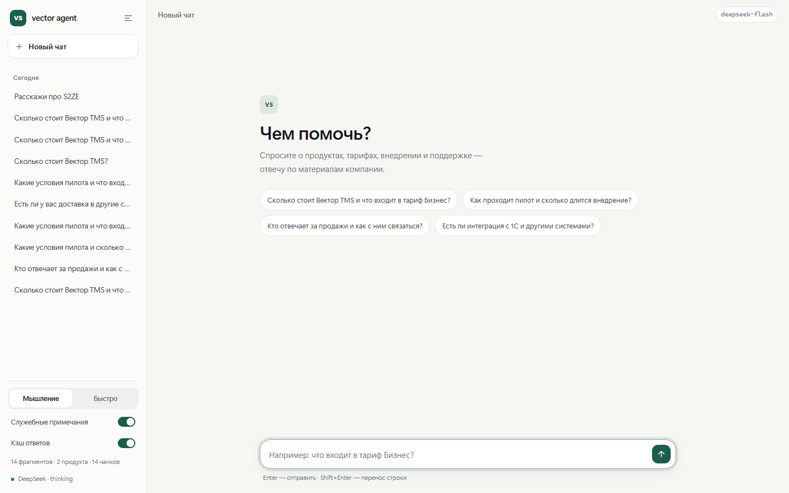
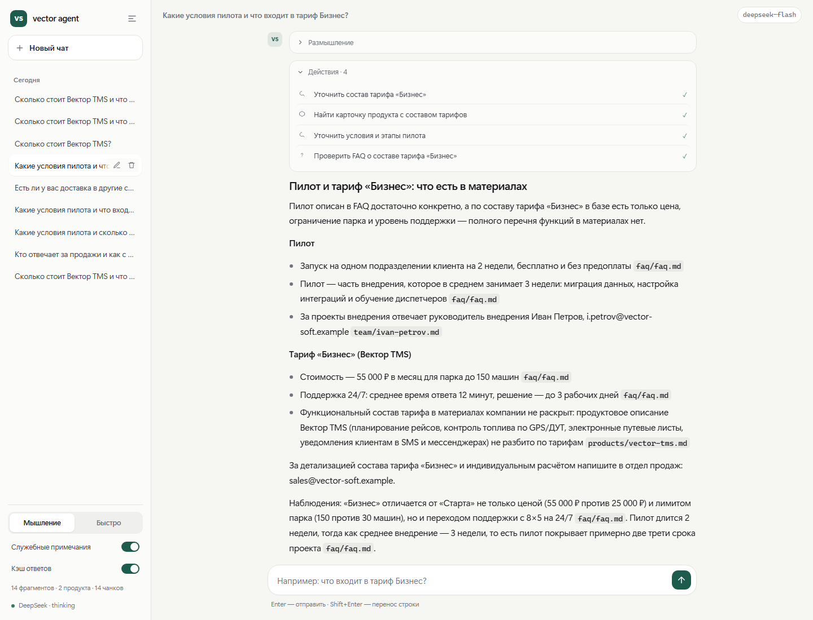

# Partner-Agent

ИИ-ассистент по компании-партнёру: отвечает на вопросы сотрудников и клиентов,
опираясь только на открытые источники и материалы, которые предоставила компания.
Каждый факт сопровождается ссылкой на источник.

Вторая часть проекта: RAG-движок, интерфейс, кэш ответов и мультиязычность
перенесены из `../`, предметная область заменена на компанию.
Первая часть осталась без изменений.





## Быстрый старт

```bash
# из папки partner-agent
python ingest.py            # собрать базу знаний (BM25 + эмбеддинги)
python app.py               # http://127.0.0.1:8001
```

Проверка без сервера:

```bash
python tests/test_partner.py
```

## Что где лежит

```
partner-agent/
├── app.py                  # запуск веб-чата (порт 8001)
├── ingest.py               # сборка базы: --no-web, --skip-embeddings, --incremental
├── data/company/             # материалы компании (см. README внутри)
│   ├── profile.json          # карточка компании
│   ├── agent.json            # персона, правила, глоссарий, брендинг
│   ├── about/ products/ faq/ news/ docs/
│   └── urls.txt              # открытые источники
├── data-temp/                # рабочий стол сбора данных (в индекс не попадает)
│   ├── 00-meta/              # правила, реестр источников, покрытие тем
│   ├── 01-web/ … 08-contacts/  # каталоги каналов: сайт, пресса, соцсети, реестры
│   ├── 09-company/           # «сырые» материалы по папкам как в data/company
│   └── 10-templates/         # шаблоны карточек и JSON-конфигов
├── tools/data_audit.py       # проверка базы перед сборкой индекса
├── tools/crawl_site.py       # обход сайта и раскладка материалов в data-temp
├── partner/
│   ├── config.py           # настройки, провайдер модели, пути
│   ├── engine/             # RAG-движок
│   │   ├── chunking.py bm25.py tokenize.py embeddings.py vectorstore.py
│   │   ├── llm.py          # DeepSeek API или Ollama, один протокол
│   │   ├── db.py           # SQLite: сессии, сообщения, кэш
│   │   ├── answers.py      # кэш ответов (TTL, языки, режимы)
│   │   ├── lang.py         # язык ответа = язык вопроса
│   │   └── compat.py logbook.py types.py
│   ├── domain/             # предметная область компании
│   │   ├── sources.py      # коннекторы: файлы, URL, профиль
│   │   ├── entities.py     # карточки: компания, продукт, человек, FAQ, новость
│   │   ├── loaders.py      # сборка Knowledge + обзор базы
│   │   └── retriever.py    # гибридный поиск: dense + BM25 + сущности
│   ├── agent.py            # агент: инструменты, режимы, цитаты
│   ├── prompts.py          # промпты и схемы инструментов
│   ├── api.py              # FastAPI + SSE + история + кэш
│   ├── schemas.py          # Pydantic-модели
│   └── web/                # интерфейс (перенесён из первой части)
├── docs/architecture.md    # архитектура и соответствие кейсу
└── tests/test_partner.py   # тесты домена и API
```

## Данные компании

База заранее неизвестна, поэтому контракт простой: положить файлы в `data/company/`
по папкам — `about/`, `products/`, `team/`, `faq/`, `news/`, `docs/`. Поддерживаются
PDF, DOCX, HTML, Markdown, TXT, JSON, CSV. Ссылки на открытые страницы — в
`data/company/urls.txt`. Карточка компании — `profile.json`, если её дали;
иначе компания соберётся из `about/`.

Сейчас внутри — реальный кейс хакатона «НЭТИ-НЕКСТ 2.0»: **UserGate**, российский
разработчик решений в сфере информационной безопасности.

| Что | Сколько |
|---|---|
| Файлов материалов | ~3416 (37,9 МБ) |
| Документов после разбора | 3487 |
| Фрагментов в индексе | 35 216 |
| Карточек продуктов | 10 |
| Пар «вопрос — ответ» | 69 |
| Новостей и постов (Telegram, VK) | 634 |
| Страниц документации, сайта и статей Habr | 2756 |
| Терминов в BM25-словаре | 46 561 |

Собрано из материалов организаторов (`UserGate.docx`, `USERGATE.txt`), официального
портала документации `docs.usergate.com`, основного сайта `usergate.com` (обход
через браузер), выгрузок Telegram, VK и Habr, а также страниц контактов и вакансий.
Происхождение каждого блока зафиксировано в `data/company/docs/source-registry.md`.

Особенности этой базы, заданные описанием кейса:

- сертификат ФСТЭК указан только для UserGate NGFW — обобщение «все продукты
  сертифицированы» в базу не попало;
- цены и сроки поставки отсутствуют намеренно: зафиксирован правильный ответ
  «данных нет, вот официальный канал»;
- функции продуктов привязаны к версиям;
- обрывки поисковой выдачи из справки партнёра удалены;
- сведения справки партнёра помечены как требующие подтверждения официальной
  страницей.

## Сбор данных и проверка базы

`data-temp/` — рабочий стол для сбора новых материалов. Папка не попадает в
индекс: `ingest.py` читает только `data/company/`. Внутри — каталоги каналов
(сайт, документация, Академия, пресса, Telegram и другие соцсети, реестры
ФСТЭК/Минцифры/Минпромторга, партнёры, мероприятия, карьера, контакты),
шаблоны карточек и чек-лист переноса. Подробности — в `data-temp/README.md`.

Проверка перед сборкой:

```bash
python tools/data_audit.py               # структура, JSON, мусор, сущности
python tools/data_audit.py --check-urls  # плюс доступность URL из urls.txt
python tools/build_source_links.py       # карта «файл материала → ссылка»
python tools/find_conflicts.py           # противоречия и дубли в данных
```

**Ссылки в ответах.** Агент показывает в «Источниках» ссылки, а не имена файлов.
Карта лежит в `data/company/source-links.json`: у крауленных страниц берётся `url`
из шапки файла, у курируемых карточек — каноническая страница из `tools/build_source_links.py`.
После правки материалов карту надо пересобрать, иначе новая карточка останется без ссылки.

Скрипт ловит невалидный JSON, битые Q/A-пары, запрещённые артефакты вроде
обрывков поисковой выдачи и падение числа продуктов или FAQ.

### Обход сайта

`tools/crawl_site.py` собирает материалы сайта в `data-temp/` — в `data/company/`
он не пишет и индекс не меняет:

```bash
python tools/crawl_site.py --profile usergate-docs --dry      # что будет обойдено
python tools/crawl_site.py --profile usergate-docs --limit 30 # пробный обход
python tools/crawl_site.py --profile usergate-docs            # полный обход
python tools/crawl_site.py --profile usergate-main            # основной сайт
```

Профиля два, потому что сайты устроены по-разному:

| Профиль | Сайт | Как берём | Объём |
|---|---|---|---|
| `usergate-docs` | `docs.usergate.com` | обычный HTTP — сервер отдаёт готовый HTML | 3181 URL, ~3,5 стр/с |
| `usergate-main` | `usergate.com` | headless Chrome/Edge: страница рендерится как у посетителя | 150 URL, ~1 стр / 10 с |

Основной сайт — SPA: без JavaScript приходит пустая оболочка на 2997 байт. Поэтому
для него инструмент открывает каждую страницу в установленном браузере
(`--headless=new --dump-dom`) и забирает готовый DOM. Подмену user-agent под
Googlebot не используем: сервер отдаёт контент роботам, но выдавать себя за них
некорректно.

Инструмент соблюдает `robots.txt`, берёт список страниц из `sitemap.xml`
(включая вложенные карты), вычищает шаблон (меню, «Поделиться», подсказки BBCode,
счётчики, CTA-кнопки), вытаскивает продукт, версию, раздел, `ID статьи` и ревизию,
отбрасывает дубли и пустые оболочки. Результат: чистый Markdown по продуктам,
реестр обхода, карта разделов и готовые строки CSV для каталогов `data-temp/01-web/`.
Повторный запуск продолжает с места остановки.

### Инкрементальная сборка векторов

По умолчанию каждый `ingest.py` считает эмбеддинги заново для всех фрагментов.
Флаг `--incremental` пересчитывает только новые и изменённые:

```bash
python ingest.py               # полная сборка, попутно пишет кеш векторов
python ingest.py --incremental # только изменённое
```

Кеш лежит в `storage/index/vectors.npz` («id фрагмента → хеш текста + вектор»).
Фрагмент переиспользуется, если совпали id и хеш текста; в ключ кеша входят модель
эмбеддингов и параметры нарезки, поэтому их смена автоматически сбрасывает кеш —
смешивать векторы разных моделей нельзя. Если кеша нет, а Chroma уже собрана,
первый `--incremental` заполнит кеш из неё, ничего не пересчитывая.

### Режимы просмотра базы

Документация занимает 96,8 % фрагментов, поэтому быстрым ответам она мешает.
Режим просмотра отсекает тяжёлые типы фрагментов прямо при поиске — по метаданным
`kind`, которые уже есть в индексе (пересборка не нужна):

```json
"retrieval": {
  "view": "full",
  "views": { "core": ["doc", "web"], "full": [] },
  "view_by_mode": { "fast": "core" }
}
```

`core` («кратко») — около 964 фрагментов из 35 тыс.: продукты, FAQ, новости, о компании.
`full` — вся база вместе с документацией. Фильтр применяется и к плотному поиску
(через `where` в Chroma), и к BM25, и к бусту по сущностям. По умолчанию режим
`full`, поэтому поведение без настройки не меняется.

### Защита контекста от дублей

Одни и те же статьи документации лежат в деревьях разных продуктов (`ngfw/`,
`dcfw/`, `swg/`, `waf/`…), а фрагменты соседних абзацев перекрываются. Без чистки
выдача по общей теме почти целиком состояла из повторов:

| Запрос | Близких пар в топ-8 до | После |
|---|---|---|
| «Пользователи и группы» | 10 | 1 |
| «Настройка сети и VLAN» | 27 | 3 |
| «Кластеризация и отказоустойчивость» | 14 | 3 |

Чистка включена в `Retriever.search`, поэтому работает во всех каналах — и в
инструменте `search_knowledge`, и в сборке контекста:

```json
"retrieval": {
  "dedupe": true,
  "max_per_doc": 2,
  "dedupe_threshold": 0.75,
  "context_budget_chars": 6000
}
```

- `max_per_doc` — не больше двух фрагментов одного документа;
- `dedupe_threshold` — доля общих слов, при которой фрагмент считается повтором;
- `context_budget_chars` — жёсткий лимит на блок найденных фактов: даже при
  длинных фрагментах промпт не раздувается, лишнее отбрасывается.

Если понадобится сравнение продуктов, где важны почти одинаковые формулировки,
поднимите `dedupe_threshold` до 0.9 или выключите `dedupe`.

## Гибридность: профиль компании в `agent.json`

Ассистент не привязан к конкретной компании: **в коде нет ни названия, ни требований
к структуре ответа, ни тона**. Всё предметное поведение лежит в
`data/company/agent.json` (или в секции `agent` файла `profile.json`) и читается при
старте. Если файла нет — работают нейтральные умолчания, ассистент всё равно отвечает.

```json
{
  "company": "Ромашка",
  "persona": { "role": "Ты — ассистент «{company}»", "audience": "покупатели", "tone": "тёплый" },
  "style": { "heading": false, "max_bullets": 3, "allow_tables": false, "observations": 0 },
  "citations": { "required": true, "style": "section", "section_title": "Откуда данные" },
  "rules": ["Не называй цены без источника."],
  "topics": { "focus": ["букеты"], "avoid": ["доставка за границу"] },
  "fallback": "Этого нет в материалах «Ромашки».",
  "cta": { "text": "Напишите нам:", "contact": "hi@romashka.example" },
  "glossary": { "микс": "готовый букет из разных цветов" },
  "retrieval": { "top_k": 4, "context_hits": 2, "excerpt_chars": 300 },
  "limits": { "max_tokens": 1200, "fast_max_tokens": 400, "max_steps": 3 },
  "tools": ["search_knowledge", "find_product"],
  "branding": {
    "title": "Ассистент Ромашка", "brand": "romashka", "avatar": "R",
    "heading": "Что подсказать?", "subtitle": "Спросите про букеты.",
    "placeholder": "Ваш вопрос…", "examples": ["Какие есть букеты?"]
  }
}
```

Что настраивается без кода:

| Блок | Влияет на |
|---|---|
| `persona` | роль, аудитория, тон |
| `style` | заголовки, число пунктов, таблицы, длина, наблюдения |
| `citations` | обязательность ссылок, формат (inline/section/both/none), название блока |
| `rules` | свободные правила компании (запреты, обязательные оговорки) |
| `context` | первоначальный контекст: кто пользователи, карта продуктов и различий, границы работы |
| `topics` | фокус и запретные темы |
| `fallback` | что говорить, когда данных нет |
| `cta` | призыв к действию и контакт |
| `language` | `auto` (язык вопроса) или фиксированный язык |
| `glossary` | термины компании, которые модель обязана понимать одинаково |
| `retrieval` | сколько фрагментов и какой длины попадает в контекст |
| `limits` | бюджет токенов и число шагов инструментов |
| `tools` | какие инструменты доступны |
| `branding` | заголовок, подзаголовок, примеры, плейсхолдер, аватар в интерфейсе |

Экономия и скорость тоже настраиваются: уменьшите `context_hits`, `excerpt_chars`,
`max_tokens` и `max_steps` — ассистент станет дешевле и быстрее без изменения кода.
Интерфейс забирает брендинг из `GET /api/agent/profile`, поэтому под новую компанию
меняются только данные.

### Как подключить новую компанию

1. Положить материалы в `data/company/` (папки `about/`, `products/`, `team/`, `faq/`, `news/`).
2. Заполнить `profile.json` и `agent.json` (можно скопировать демо и поправить).
3. `python ingest.py && python app.py` — всё, код не трогаем.

## Возможности

- **Гибридный поиск**: эмбеддинги (fastembed) + BM25 + буст по продуктам и людям,
  слияние через RRF.
- **Карточки знаний**: компания, продукты, сотрудники, FAQ, новости; FAQ
  разбирается на пары «вопрос/ответ».
- **Агент с инструментами**: `search_knowledge`, `company_profile`, `find_product`,
  `find_person`, `find_faq`, `kb_stats`, `plan`.
- **Ссылки на источники** в каждом ответе: файл материала или URL страницы.
- **Режимы ответа**: «Авто» (по умолчанию: модель оценивает сложность вопроса
  и сама выбирает быстро, мышление или уточнение), «Мышление» (инструменты,
  рассуждение) и «Быстро» (один вызов, максимум экономии). Выбор «Авто»
  показывается бейджем под ответом, а классификатор работает на коротком
  запросе с запасным вариантом-эвристикой. Если вопрос требует уточнения,
  авто-режим сразу переходит к карточке выбора, не генерируя полный ответ. Для очевидных вопросов
  классификатор не вызывается — это экономит секунду на каждый ответ.
- **Ответы объясняют, а не отчитываются**: 3–4 коротких абзаца, ориентир — до 900
  символов (быстрый режим — до 500). Сначала что это и зачем, потом детали; живой
  язык без канцелярита и маркетинга, термины расшифровываются при первом упоминании.
  Без вступлений, повтора вопроса и общих выводов; сравнение продуктов — таблицей до
  5 строк. Продолжения вроде «а где этому научиться» держатся в контексте прошлой темы.
- **История диалога** в SQLite: сессии, сообщения, источники, шаги, токены.
- **Уточняющие вопросы**: если вопрос слишком общий или не хватает параметров,
  модель вызывает `ask_clarification` и готовит 2–4 вопроса. Они показываются
  по одному: прогресс «вопрос N из M», кнопки «Назад/Далее», 2–3 варианта и
  своё поле. Опрос можно закрыть маленьким × и сразу получить ответ.
- **Кнопки продолжения**: 2–4 варианта строятся локально по вопросу и ответу
  после содержательного ответа — без отдельного вызова модели. Каждая кнопка
  привязана к предмету ответа: соседняя сборка и изменения линейки, актуальная
  версия продукта, вопрос с той же карточки FAQ, термин из ответа или канал,
  который в нём назван. Случайные совпадения слов (`«Возможности NGFW»` после
  вопроса про сборку) отбрасываются: если привязки нет, кнопок не будет.
  Сотруднику (`«Служебные примечания»` включены) предлагаются рабочие вопросы —
  сборки, изменения, совместимость, канал поддержки; продающие формулировки
  (цена, скидки, пробный период) скрываются. Клиенту — `«что нового»`,
  `«какие версии»`, `«куда написать»`. Нажатие отправляет текст как сообщение
  клиента, варианты сохраняются в истории.
- **Умный кэш ответов**: TTL, разделение по языку/режиму, версия промптов и
  хэш контекста диалога. Похожий вопрос не получит ответ из другого контекста,
  а после пересборки базы или смены промптов старые записи не используются.
- **Ответ после опроса**: один вызов без инструментов, с полным контекстом и
  каталогом программ; ответы опроса сохраняются как скрытый контекст и не
  показываются в чате.
- **Мультиязычность**: ответ на языке вопроса.
- **Клиентский режим**: при выключенном тумблере «Служебные примечания» из ответа
  убираются источники и ссылки на файлы, а панели «Размышление», «Действия» и
  «Источники» не показываются. Остаются ответ и follow-up кнопки; при включённом
  тумблере видна вся служебная информация.
- **Провайдер модели** переключается: DeepSeek API или локальная Qwen через Ollama.

## Настройка

Скопируйте `.env.example` в `.env` и заполните:

```env
PARTNER_COMPANY=Название компании
LLM_PROVIDER=deepseek            # или ollama
DEEPSEEK_API_KEY=...
```

Локальная модель:

```env
LLM_PROVIDER=ollama
OLLAMA_MODEL=qwen2.5:3b-instruct
```

## API

| Метод | Путь | Назначение |
|---|---|---|
| `GET` | `/api/health` | состояние: компания, фрагменты, продукты, люди, FAQ |
| `GET` | `/api/kb/stats` | состав базы и кэша |
| `POST` | `/api/retrieve` | поиск без модели (`query`, `top_k`) |
| `POST` | `/api/chat` | чат (SSE): `message`, `session_id`, `mode`, `use_cache` |
| `GET/POST` | `/api/sessions` | список и создание чатов |
| `GET/PATCH/DELETE` | `/api/sessions/{id}` | история, переименование, удаление |
| `DELETE` | `/api/cache` | очистить кэш ответов |

## Документация

- [docs/architecture.md](docs/architecture.md) — слои, поток данных, профиль компании, что перенесено из первой части.
- [docs/rag-methods.md](docs/rag-methods.md) — карта методов RAG: что бывает, сколько стоит, что выбрать для Partner-Agent и как измерять эффект.

## Дизайн интерфейса

Интерфейс сознательно тихий: бумажная поверхность, один акцент, текст как
основной носитель информации. Никаких «карточек на всё» и градиентных подложек:
структура задаётся типографикой, волосяными линиями и воздухом.

- **Токены**: палитра `--paper/--surface/--ink/--muted/--line/--accent`,
  системный шрифт Segoe UI Variable, моно для кода и чисел; шкала движения
  `--t-fast 140ms`, `--t-base 220ms`, `--t-slow 320ms` и сильный ease-out
  `cubic-bezier(0.23, 1, 0.32, 1)`.
- **Движение только по делу**: появление сообщения (сдвиг 8px + прозрачность),
  мягкая каретка при стриминге, появление шагов действия, раскрытие
  «Размышления» и «Источников» через `::details-content`, финальная сборка
  блоков ответа, кнопка «вниз». Всё — на `transform`/`opacity`, ничего не
  дёргает вёрстку.
- **Реальное время**: размышления обновляются раз в кадр с автоскроллом и
  таймером в шапке, действия добавляются по мере вызова инструментов, счётчик
  «Действия · N» и статус «выполняется».
- **Живой статус**: во время ответа показываются «Думаю…», «Читаю данные…», «Проверяю факты…», «Пишу ответ…» с плавной сменой текста.
- **Доступность**: видимый `:focus-visible`, `role="status"` у индикатора,
  поддержка `prefers-reduced-motion` (анимации отключаются полностью),
  контраст текста и таблиц.
- **Тёмная тема**: системная через `data-theme`, принудительно —
  `?theme=light` или `?theme=dark` (удобно для скриншотов и проверки контраста).
- **Акцент компании**: `branding.accent` из `agent.json` задаёт `--brand-accent`;
  в тёмной теме он автоматически светлеет через `color-mix`, чтобы оставаться
  читаемым.

Скриншоты: [пустое состояние](docs/ui-empty.png), [ответ с источниками](docs/ui-chat.png).

## Ограничения
- Нет доступа к внутренним системам партнёра: только материалы и открытые страницы.
- Цены и условия берутся из документов; если их не прислали — ассистент скажет, что
  данных нет, и предложит запросить материалы.
- `usergate.com` отдаёт страницы как SPA и закрыт капчей, поэтому `/products`,
  `/academy/courses-exams` и `/registry-entry` не загружаются автоматически: это
  канонические адреса для проверки человеком. Текст официальной документации
  берётся с `docs.usergate.com`, который отдаёт содержимое сервером.
- Технические характеристики по моделям оборудования в базу не перенесены: они
  зависят от платформы и проверяются в datasheet'ах.
- Персональных данных сотрудников в базе нет — только контакты по направлениям.
